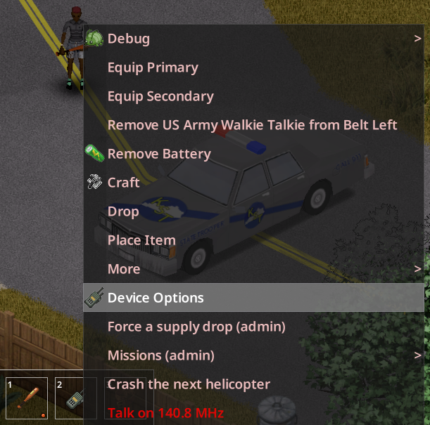
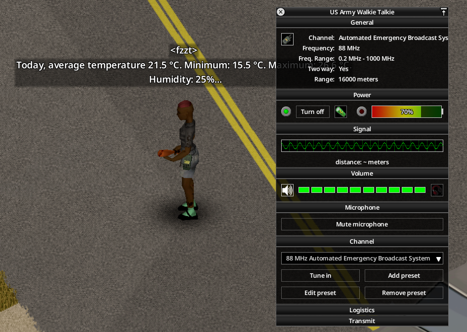

# Belt Walkie-Talkie

**Project Zomboid Build 42.21 · Singleplayer & Multiplayer · Requires [TooltipLib](https://steamcommunity.com/sharedfiles/filedetails/?id=3694097672)**

A walkie-talkie hooked on the belt can be tuned, stays on when its window is open, hears the station it is tuned to in singleplayer, shows a radio bubble in multiplayer, drains its battery, plays the radio sound as in hand (static, then the broadcast sound for each line received; only its owner hears it) and makes a noise that attracts zombies when it receives a line. It never transmits from the belt: take it in hand (or wear a radio on the back) to talk. A radio stored in the inventory hears nothing in singleplayer.

Walkie-talkies, HAM radios and the military backpack radio can be adapted for mains power (recipe *Adapt Radio for Mains Power*, Electrical 1): in an electrified area their battery no longer drains and recharges.

This mod is also the shared receiver (`BatmanRadio`) of Military Drop, Operation Artemis and Radio Survivor, extracted from Military Drop (`source/radio`, commit `15d1066`).





- Mod ID: `batman_BeltRadio` (Workshop ID: [3817018338](https://steamcommunity.com/sharedfiles/filedetails/?id=3817018338))
- Player and admin guide (wiki): [docs/wiki/en/Home.md](docs/wiki/en/Home.md)
- Developer documentation (in French): [docs/README.md](docs/README.md), Lua API for other mods: [docs/specifications-techniques/api-publique.md](docs/specifications-techniques/api-publique.md)
- Design decisions (in French): [docs/decisions.md](docs/decisions.md)
- Changes: [CHANGELOG.md](CHANGELOG.md)

## Sandbox options

Page `BeltRadio`, booleans `true` by default; `false` gives back the vanilla behaviour, read at each use (a change in the middle of a game applies at once).

| Option | Effect |
|---|---|
| `BeltRadio.MPBubble` | Multiplayer: radio bubble above the player for a line received by a walkie-talkie on the belt |
| `BeltRadio.BeltBattery` | Battery drain of a switched-on walkie-talkie at the belt |
| `BeltRadio.BeltListening` | Singleplayer: a walkie-talkie at the belt hears its station |
| `BeltRadio.BeltNoise` | Noise that attracts zombies when a walkie-talkie at the belt receives a line |
| `BeltRadio.BeltAudio` | Radio sound of a switched-on walkie-talkie at the belt, as in hand (static, broadcast sound for each line), heard by its owner only |
| `BeltRadio.MainsRechargeHours` | Integer, 10 by default: in-game hours for an adapted radio to recharge an empty battery on mains power |

## Repository layout

```
Contents/mods/batman_BeltRadio/
  common/          Build 42 common folder
  42.21/           mod.info, poster, icon and media (Lua, sandbox options, translations)
    media/lua/client/BatmanRadio/   receiver (menu, window, singleplayer listening, MP bubble, battery, noise, sound),
                                    mains power of carried radios, TooltipLib line
    media/lua/shared/BatmanRadio/   API shared with the server (VERSION, options, canTransmitWith), mains power
                                    rules and recipe code, BWT compatibility
    media/lua/server/BatmanRadio/   mains power of placed radios (singleplayer, server)
    media/scripts/                  recipe Adapt Radio for Mains Power
docs/              developer documentation (French), wiki sources (docs/wiki/en, docs/wiki/fr), screenshots
tests/             checks without the game (lupa)
README.steam*      Steam Workshop descriptions (English = workshop.txt)
```

## Checks

```
pip install lupa pillow
python tests/run_all.py
```

Luacheck (if installed), Lua 5.1 syntax and Kahlua constraints, `mod.info`, sandbox options and translations, Steam descriptions (8,000-byte limit), path case (Linux), and the Lua tests (game API simulated with `lupa`). Nothing here is an in-game test.

## License

MIT, see [LICENSE](LICENSE).

---

## Français

Un talkie-walkie accroché à la ceinture se règle, reste allumé quand sa fenêtre est ouverte, entend en solo la station sur laquelle il est réglé, affiche une bulle radio en multijoueur use sa pile, fait entendre le son de la radio comme en main (grésillement, puis son de l'émission à chaque ligne reçue ; seul son porteur l'entend) et fait un bruit qui attire les zombies quand il reçoit une ligne. Il n'émet jamais depuis la ceinture : il faut le prendre en main (ou porter une radio sur le dos) pour parler. Une radio rangée dans l'inventaire n'entend rien en solo.

Talkies-walkies, radios HAM et radio militaire dorsale se bricolent pour le secteur (recette « Adapter la radio au secteur », Électricité 1) : dans une zone électrifiée, leur pile ne s'use plus et se recharge. Prérequis : TooltipLib.

Ce mod est aussi le récepteur commun (`BatmanRadio`) de Military Drop, Opération Artemis et Radio Survivor, extrait de Military Drop (`source/radio`, commit `15d1066`).

- Identifiant : `batman_BeltRadio` (Workshop [3817018338](https://steamcommunity.com/sharedfiles/filedetails/?id=3817018338))
- Guide du joueur (wiki) : [docs/wiki/fr/Home.md](docs/wiki/fr/Home.md)
- Documentation de développement : [docs/README.md](docs/README.md) ; API Lua pour les autres mods : [docs/specifications-techniques/api-publique.md](docs/specifications-techniques/api-publique.md)
- Décisions de conception : [docs/decisions.md](docs/decisions.md)
- Vérifications hors jeu : `python tests/run_all.py`
