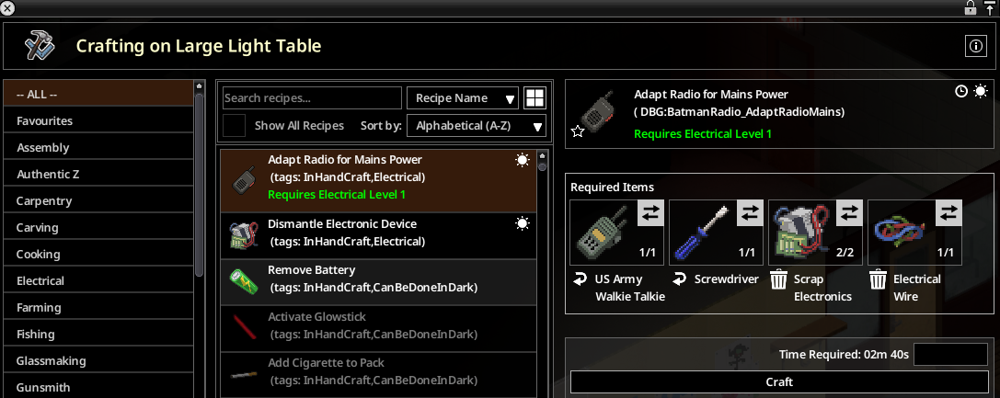

# Spécifications fonctionnelles

Belt Walkie-Talkie 1.2.0, Build 42.21, solo et multijoueur. Prérequis : TooltipLib. Contrats techniques : [specifications-techniques](specifications-techniques/README.md). Motifs des choix : [decisions.md](decisions.md).

Vocabulaire : un talkie **accroché** est porté sur un emplacement d'accroche (ceinture…), ni en main ni sur le dos (`isAttachedOnly`) ; une radio **rangée** est dans l'inventaire principal ou un sac sans être accrochée ni tenue.

## Talkie-walkie à la ceinture

### F01 — Menu « Options de l'appareil »
Clic droit sur une radio portative accrochée : option vanilla **Options de l'appareil** (`IGUI_DeviceOptions`), qui ouvre la fenêtre de réglage vanilla (fréquence, allumage, volume, préréglages). Une seule option, même si plusieurs objets sont sélectionnés. Un mod inscrit (fournisseur `isStowed`/`open`) peut aussi l'offrir pour une radio rangée. Aucune option sandbox.

### F02 — Fenêtre gardée ouverte
Le vanilla éteint une radio dont la fenêtre est ouverte quand elle n'est ni en main ni sur le dos. Pour un talkie accroché, ou pendant sa prise en main (action `ISEquipWeaponAction` ou action déclarée par un mod, en file ou en cours), la fenêtre reste ouverte et la radio allumée. Aucune option sandbox.

### F03 — Écoute à la ceinture en solo
Un talkie accroché, allumé, avec du volume et une pile chargée, entend la chaîne sur laquelle il est réglé : stations vanilla, diffusion d'urgence, chaînes ajoutées par des mods. La ligne s'affiche dans une bulle radio au-dessus du personnage, en clair ou brouillée et grise par l'orage comme en main ; les publicités et pauses s'affichent en gris. Pas de doublon si la radio en main reçoit déjà la fréquence. Option `BeltListening`.

### F04 — Bulle radio en multijoueur
En MP, le jeu fait déjà recevoir les radios allumées de l'inventaire principal, mais seulement dans le chat radio. Une ligne de chaîne reçue par un talkie accroché s'affiche aussi dans une bulle radio au-dessus du joueur, en blanc, ou dans la couleur déclarée par le mod qui possède la chaîne. Pas de bulle pour une radio rangée, ni si la radio équipée reçoit déjà la fréquence, ni pour les messages des autres joueurs ; une même ligne n'est affichée qu'une fois en 2 s. Désactivée quand Better Walkie Talkies est actif. Option `MPBubble`.

### F05 — Usure de la pile à la ceinture
Un talkie accroché allumé consomme sa pile chaque minute de jeu, comme en main. Option désactivée : charge figée à la ceinture, consommation rattrapée par le vanilla à la reprise en main. Inactive quand Better Walkie Talkies est actif (il gère la pile). Option `BeltBattery`.

### F06 — Bruit qui attire les zombies
À chaque ligne reçue par un talkie accroché allumé (solo : lignes de F03 ; MP : lignes du chat radio sur sa fréquence), un bruit est émis comme en main : volume `100 × volume de l'appareil`, portée de l'appareil, aucun bruit avec des écouteurs ou à volume nul, au plus un bruit toutes les 2 s par radio. Le vanilla n'en fait qu'à la première ligne. Option `BeltNoise`.

### F07 — Son de la radio à la ceinture
Un talkie accroché, allumé et alimenté fait entendre le son de la radio comme en main : grésillement continu, puis environ 5 s du son d'émission (`BroadcastEmergency` pour un canal d'urgence, sinon `RadioTalk`) à chaque ligne reçue, et un « zap » au retour au grésillement. Volume selon le réglage de l'appareil. Seul le porteur l'entend. Arrêt quand le talkie est décroché, pris en main (le vanilla reprend), éteint, vide, ou l'option désactivée. Les lignes « Bzzt » écrites d'une radio en main ne sont pas reproduites. Option `BeltAudio`.

### F08 — Pas d'émission depuis la ceinture
Ce mod n'ajoute aucune émission depuis la ceinture : pour parler, il faut le talkie en main ou une radio sur le dos. Il fournit aux mods dépendants le prédicat `canTransmitWith`, qui refuse une radio accrochée (raison `belt`) ou rangée (`stowed`) ; chaque mod affiche son propre message. Le comportement vanilla de la voix (VOIP) n'est pas modifié par ce mod (à confirmer en jeu, voir Limites).

### F09 — Radio rangée
Une radio rangée n'entend rien en solo (comme le vanilla) et n'a jamais de bulle ajoutée par ce mod. En MP, le vanilla lui fait quand même recevoir les lignes dans le chat radio.

## Radios sur secteur

### F10 — Recette « Adapter la radio au secteur »
Recette d'artisanat en main (catégorie Électricité) : Électricité 1, un tournevis gardé, 2 pièces électroniques, 1 fil électrique ; rapporte 10 XP d'Électricité. Appareils : talkies-walkies (Toys-R-Mine, ValuTech, Premium Technologies, tactique, Armée américaine, artisanal), radioamateurs (Premium Technologies, Armée américaine, artisanale) et poste radio nomade de l'Armée américaine, à pile. L'appareil est gardé (canal, pile, identifiant conservés). Refusée sur un appareil déjà bricolé. Connue d'emblée, pas de fabrication par lots.

### F11 — Radio bricolée portée
Portée en main, sur le dos ou accrochée, dans une zone électrifiée (générateur, ou réseau public à l'intérieur d'une pièce) : la pile ne s'use plus et se recharge, appareil allumé ou éteint, jusqu'à pleine charge, en `MainsRechargeHours` heures de jeu depuis vide. Hors zone : usure d'origine. Une pile doit être dans l'appareil. Aucun rattrapage du temps passé hors du jeu.

### F12 — Appareil bricolé posé
Même règle pour un appareil posé : objet 3D lâché ou transféré au sol (lié par `RadioItemID`), ou tuile (radioamateurs, « Placer » d'un talkie), d'après la case de l'appareil, mise à jour chaque minute de jeu sur le solo ou le serveur. Un radioamateur posé puis ramassé reste bricolé.

### F13 — Infobulle
L'infobulle d'un appareil bricolé affiche « Bricolée pour le secteur », et « En charge sur le secteur » quand il se recharge (via TooltipLib).

## Pour les autres mods

### F14 — Récepteur radio commun
Military Drop, Opération Artemis et Radio Survivor s'appuient sur ce mod (prérequis) pour la ceinture : leurs chaînes, fréquences publiques ou secrètes reconnues par les codes de ligne, menu d'une radio rangée, actions de prise en main, prédicat d'émission. API : [api-publique.md](specifications-techniques/api-publique.md).

### F15 — Better Walkie Talkies
Détecté (`BetterWalkieTalkies`, `BetterWalkieTalkiesDev`). Avec lui : pas de pile à la ceinture ni de bulle MP ajoutées par ce mod ; l'écoute solo (F03) reste active ; le contrôle du micro passe par son pont pour ne pas confondre son silence de repos avec un micro coupé.

## Options sandbox

Page **Talkie-walkie à la ceinture** (`BeltRadio`). Lues à chaque usage : un changement en cours de partie s'applique aussitôt. Une option booléenne fausse rend le comportement vanilla.

| Option | Défaut | Effet |
|---|---|---|
| Bulle pour une radio non tenue (multijoueur) — `MPBubble` | activée | F04 |
| Usure de la pile à la ceinture — `BeltBattery` | activée | F05 |
| Écoute à la ceinture (solo) — `BeltListening` | activée | F03 |
| Bruit d'un talkie-walkie à la ceinture — `BeltNoise` | activée | F06 |
| Son d'un talkie-walkie à la ceinture — `BeltAudio` | activée | F07 |
| Recharge sur secteur (heures) — `MainsRechargeHours` | 10 (1 à 240) | F11, F12 |

F01, F02 et F10 ne dépendent d'aucune option.

## Solo et multijoueur

| Fonction | Solo | Client MP | Serveur |
|---|---|---|---|
| F01, F02 | oui | oui | — |
| F03 écoute | oui | vanilla (chat radio) | — |
| F04 bulle | — | oui | — |
| F05 pile ceinture | oui | oui | — |
| F06 bruit, F07 son | oui | oui (lignes du chat radio) | bruit relayé |
| F10 recette | oui | lancée par le client, `OnCreate` sur le serveur | oui |
| F11 portée | oui | oui | apprend la charge par les paquets vanilla |
| F12 posée | oui | — | oui |

## Limites connues

- MP : la charge d'une radio portée n'arrive au serveur que par les paquets de pile vanilla envoyés quand elle est allumée.
- MP : bruit et son des messages radio des autres joueurs dépendent de l'événement du chat radio, non vérifiés en jeu.
- Rendu FMOD du son à la ceinture (paramètre `DeviceVolume` sur un émetteur libre) à vérifier en jeu.
- F04 : la couleur d'une ligne d'une chaîne inconnue n'est pas transmise par l'événement : blanc, et le gris du brouillage est perdu.
- Une radio ramassée sous 1.1.0 a perdu sa modification : la bricoler de nouveau.
- F08 : effet de ce mod sur la VOIP vanilla d'un talkie accroché non documenté par le code ; à confirmer en jeu.
