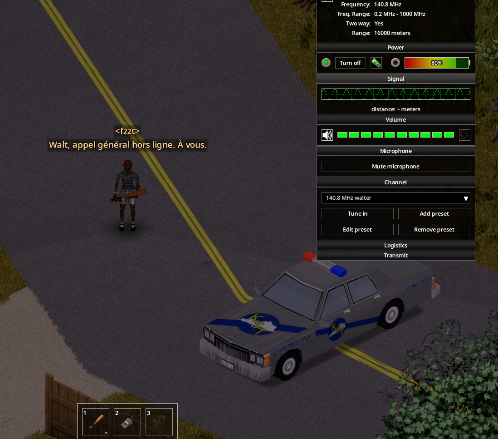

# Walkie-talkie on the belt

A walkie-talkie is "on the belt" when it is hooked on an attachment slot and is neither in your hands nor on your back. In vanilla such a walkie-talkie cannot be tuned, switches off as soon as its window is open, and hears nothing in singleplayer.

## Device Options

Right-click the walkie-talkie on your belt: **Device Options** opens the usual radio window (frequency, power, volume, presets).

The window no longer switches the walkie-talkie off, even while you take it in hand.

## Listening (singleplayer)

A switched-on walkie-talkie on the belt, with volume above zero and a charged battery, hears the station it is tuned to: vanilla stations, the emergency broadcast, and stations added by mods. Lines show in a radio bubble above your character. Storms scramble them (grey text) like a walkie-talkie in hand. Commercials and pauses show in grey.

If the radio in your hand already receives the same frequency, the belt adds nothing.

## Battery

A switched-on walkie-talkie on the belt uses its battery every in-game minute, as in hand.

## Noise

Each line received makes a noise that attracts zombies, as in hand: same volume and range, none with headphones or at volume zero, at most one noise every 2 seconds per radio. In vanilla only the first line made noise.

## Sound

A switched-on walkie-talkie on the belt plays the radio sound as in hand: static while it waits, then the broadcast sound for each line received (emergency broadcast sound on the emergency channel) for about 5 seconds, then a short zap back to static. Only you hear it, as in hand. The written "Bzzt" static lines of a radio in hand are not reproduced.

## Talking

You cannot talk from the belt: take the walkie-talkie in hand, or wear a radio on your back. Mods built on Belt Walkie-Talkie (Military Drop, Operation Artemis, Radio Survivor) refuse calls from a radio on the belt and ask you to take it in hand.

## Stored radios

A radio stored in your inventory or in a bag (not hooked, not held) hears nothing in singleplayer, as in vanilla.

Listening, battery, noise and sound can each be switched back to vanilla in the [Sandbox options](04-sandbox-options.md).
